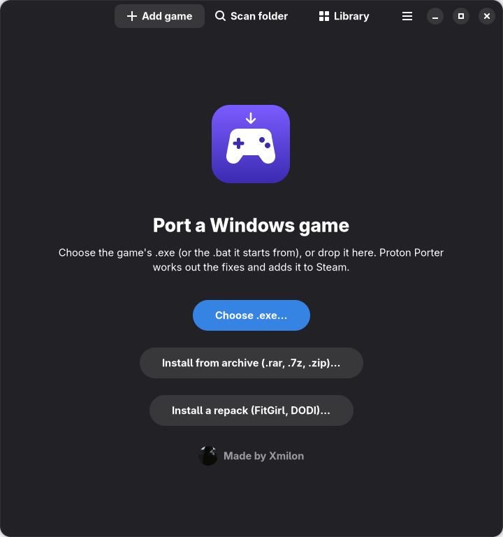
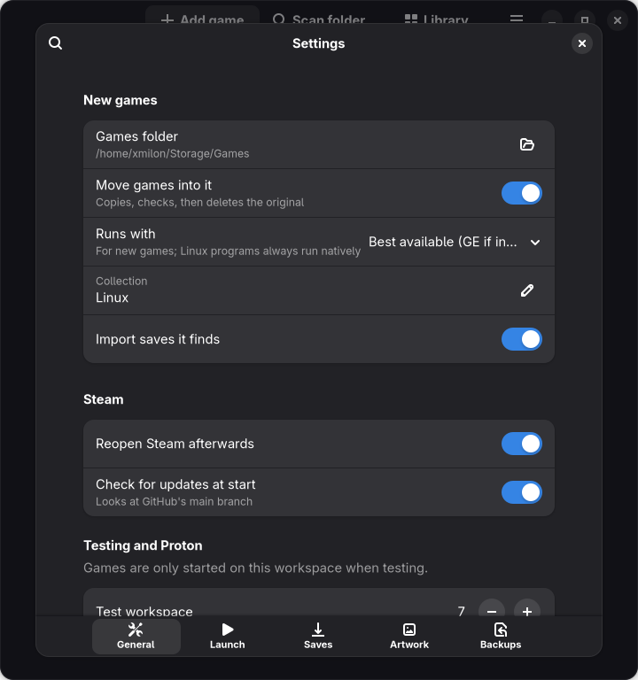
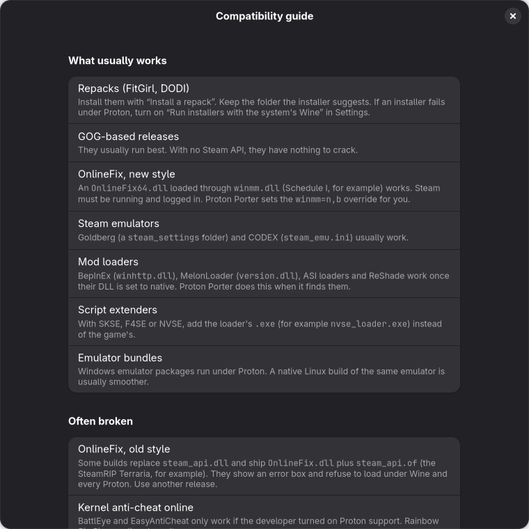

# Proton Porter

Add a Windows game you already have on disk to Steam on Linux, with the Proton
fixes already applied. When it doesn't start, Proton Porter finds out why and
tries the fixes for you.

<p>



</p>

Pick the game's `.exe` and Proton Porter:

- **finds loader DLLs** next to the game (`winmm.dll`, `version.dll`, `dinput8.dll`,
  `winhttp.dll`, `dxgi.dll`... as used by mod loaders, ASI loaders, ReShade,
  BepInEx and similar). Wine ignores these unless told otherwise, which is the
  most common reason a game that worked on Windows does nothing under Proton. It
  sets `WINEDLLOVERRIDES` for them.
- **fixes `.bat` launchers**: a `.bat` that ends in `pause` + `taskkill` closes
  the game at once under Proton. Proton Porter makes a `-linux.bat` copy
  without those lines.
- **can move the game folder** to your games folder (copies, checks the copy,
  then deletes the original). It won't move a folder that is still being
  extracted or copied.
- **spots incomplete folders**: if the `.exe` needs a DLL that is neither next
  to it nor part of Proton (say `UnityPlayer.dll`), it warns you before adding.
- **adds it to Steam** as a non-Steam game, sets the Proton version, adds the
  icon from the `.exe`, and puts it in a collection (default: **Linux**).
- **imports old saves**: it looks in `~/Documents`, `~/Old Windows` (or any
  Windows backup you point it at) for folders named after the game, plus Unity's
  `AppData/LocalLow/<company>/<game>`. It creates the game's Proton prefix, without
  starting the game, and copies the saves into it.
- **tells you what else to expect**: engine, 32/64-bit, anti-cheat, .NET/XNA,
  Visual C++ redistributables, with the `protontricks` command to run if needed.

It also has:

- **Install from an archive**: `.zip`, `.rar`, `.7z` or `.tar.*`. It extracts into your games folder,
  checks every file against the archive's listing (size and CRC), then opens the Add form.
- **Install a repack (FitGirl, DODI)**: it checks the `.bin` files against the repack's MD5 list,
  runs the installer under Proton (or the system's Wine) with the install folder already set, then
  opens the Add form.
- **Scan folder**: point it at a folder (an old `Program Files`, a games drive) and it lists every
  sub-folder with a game in it, picks the right `.exe` (it prefers script-extender loaders like
  `nvse_loader.exe`), and adds the ticked ones in one go.
- **Library**: every non-Steam game in your Steam library. For each one you can:
  - **Play** it, with a Proton log that's kept if the game crashes.
  - **Fix it…**: Proton Porter tests the game, applies the fixes its log points to (protontricks
    components, WineD3D), then tries other Proton versions, a fresh Proton folder and the
    system's Wine. It keeps the first one that works.
  - **Test & diagnose** a game, or open its **Latest log**. The log view names the crashed module,
    a missing DLL, an error box from a crack, or the game's own crash log.
  - **Log Steam launches**, for games that only crash when started from Steam.
  - Choose what it **runs with**: any Proton, the system's Wine, or no Proton (native Linux games).
  - **Show it in the app launcher** with its own icon.
  - **Uninstall** it: it runs the game's uninstaller or moves the folder to the Trash, never deletes
    for good, and refuses folders shared with other games.
- **Emulator bundles**: games that ship inside an emulator (Eden/yuzu forks, Ryujinx, Cemu, RPCS3,
  Dolphin, PCSX2, …) are recognised, and the emulator itself can be added as a second Steam entry.
- **Known cracks and mods**: OnlineFix, Goldberg, CODEX, BepInEx, MelonLoader, SKSE/F4SE/NVSE, ASI
  loaders, ReShade and Heated Metal are recognised, with the settings each one needs
  ([`known_mods.json`](proton_porter/data/known_mods.json)).
- **Compatibility guide** (in the menu): what works under Proton and what doesn't.
- **Artwork**: covers, banners and logos from SteamGridDB (free API key, set in Settings).
- **Settings**: default games folder, Proton version, collection, launch switches, extra folders to
  search for saves, the SteamGridDB key, repack options, the test workspace, and backups with a
  Restore button.
- **Updates**: it checks GitHub for a newer version and installs it.

Steam rewrites its settings from memory, so Proton Porter closes Steam for a
moment and reopens it. It backs up `shortcuts.vdf`, `config.vdf` and the
collections file to `~/.local/state/proton-porter/backups/<date>` first.

## Install

```sh
tar xf proton-porter-1.2.0.tar.gz
cd proton-porter-1.2.0
./install.sh            # asks before installing missing packages
```

`install.sh` works with `pacman` (Arch, Omarchy, CachyOS), `apt` (Debian, Ubuntu, Mint), `dnf`
(Fedora) and `zypper` (openSUSE). The window needs **libadwaita 1.4 or newer** (Ubuntu 24.04,
Fedora 39, Debian 13 or later). The command line also works without it. Python 3.10 or newer is needed.

Checked on Ubuntu 24.04, Debian 13, Fedora 41 and openSUSE Tumbleweed: the installer, the tests,
the command line and the window. Those checks ran in containers without Steam. Day-to-day use is on Arch
(Omarchy) with real games.

It shows up as **Proton Porter** in the app launcher. `./install.sh --remove` uninstalls it.
There's also a `PKGBUILD` (`makepkg -si`) and a single-file `proton-porter.pyz`.

Testing a game opens it on a separate workspace on Hyprland, if `hypruse` is installed. On other
desktops it opens on the current screen.

## What works

These were tried on a real machine. Your results can differ.

| Works | Doesn't |
|---|---|
| FitGirl and DODI repacks, installed through Proton Porter | Old-style OnlineFix that replaces `steam_api.dll` (`OnlineFix.dll` + `steam_api.of`): it refuses to load under Wine |
| New-style OnlineFix (`OnlineFix64.dll` through `winmm.dll`), with Steam running | Kernel anti-cheat online (BattlEye, EasyAntiCheat) unless the developer enabled Proton |
| GOG-based releases and Steam emulators (Goldberg, CODEX) | Rainbow Six Siege Y9S2 / Heated Metal on any Proton except Proton-R6HM |
| Emulator bundles (Windows emulator packages started from Steam) | Installing .NET Framework 4 into a Proton prefix (`0x80070643`) |
| XNA / .NET games through Proton's Mono (Terraria) | A heavily modded Fallout: New Vegas (GOG + NVSE plugins): crashes ~6 s after start, not solved yet |

The full list is in the app (menu → Compatibility guide) and in
[`guide.md`](proton_porter/data/guide.md).

## Use

Open it, then **Choose .exe…** (or drag the `.exe` onto the window). Check
what it found, change anything you want, and press **Add to Steam**. **Preview**
shows exactly what will be written.

Command line:

```sh
proton-porter analyze "~/Old Windows/Programmi/Some Game/Game.exe"
proton-porter add GAME.exe --move-to ~/Storage/Games --collection Linux
proton-porter add GAME.exe --args=-windowed --env "DXVK_HUD=fps" --dry-run
proton-porter install-archive Game.zip --add
proton-porter install-repack "~/Downloads/Game [FitGirl Repack]" --add
proton-porter fix "Some Game"          # test, apply fixes, try other Protons
proton-porter test "Some Game"         # one logged run, then a diagnosis
proton-porter logs "Some Game"         # newest log and what it says
proton-porter play "Some Game"         # run it; the log is kept if it crashes
proton-porter set-runner "Some Game" system-wine
proton-porter launcher "Some Game" on  # entry in the app launcher
proton-porter uninstall "Some Game"    # shows the plan; --yes to do it
proton-porter protons                  # Proton versions (and other runners)
proton-porter scan ~/Old\ Windows/Programmi
proton-porter list                     # non-Steam games in the library
proton-porter update --check
```

`add` options: `--name`, `--proton <internal name>` (also `system-wine` or `native`), `--dll NAME` /
`--no-dll NAME`, `--search DIR` (another place to look for saves), `--no-saves`, `--no-restart`,
`--mangohud`, `--gamemode`, `--log`, `--artwork`, `--with-emulator`.

## Notes

- Launch arguments: Steam can't combine `VAR=... %command%` with arguments after
  `%command%` for non-Steam games, so when both are needed the arguments go in a
  small `<game>-linux.bat` next to the `.exe`.
- Adding the same `.exe` (or name) again updates the existing shortcut instead of
  making a second one.
- Games with kernel anti-cheat that hasn't been enabled for Proton won't run
  online whatever you do.

## Disclaimer

Proton Porter is a tool for running Windows games **you are entitled to play** on Linux. It doesn't
include, download or point to any game, crack or copyrighted file. It can recognise modified game
files, because people use mods and fan patches. That doesn't mean using such files is allowed where
you live.

**You are responsible for what you run with it and for following the law and each game's licence.**
The author doesn't support piracy and isn't responsible for how the software is used. As the
[MIT licence](LICENSE) says, it comes as is, without any warranty. That includes changes it makes to
Steam's files: it backs them up first, but keep your own backups too.

Not affiliated with Valve, Steam, GOG, or any game, repack or tool named here. Names are used only to
describe compatibility.

## Made by

[Xmilon](https://github.com/Xmilon).

## Development

```sh
python3 -m proton_porter              # run from the source tree
python3 -m unittest discover tests    # tests use a fake Steam folder
scripts/build-release.sh              # dist/*.tar.gz and dist/proton-porter.pyz
```

`PROTON_PORTER_STEAM_ROOT=/some/copy` points it at a copy of a Steam folder; Steam
is never closed or opened in that mode.
